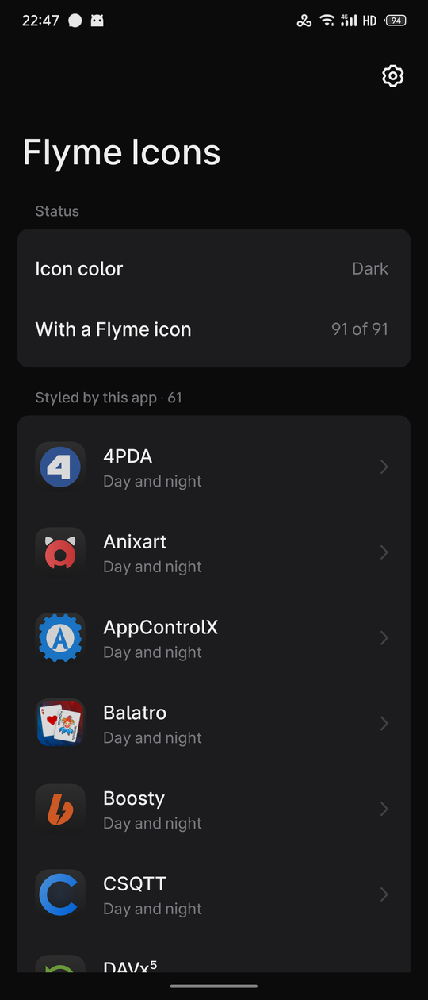
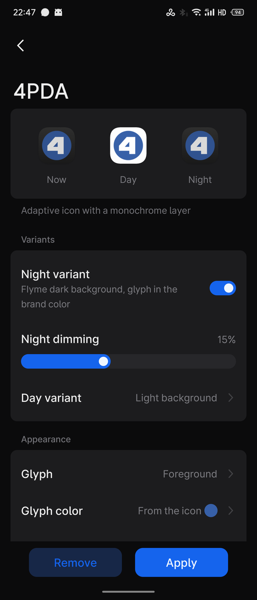
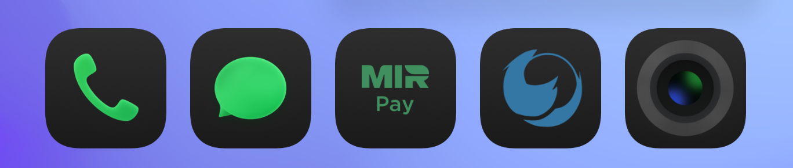

# Значки Flyme

Помощник для Flyme 12 (Meizu). Дорисовывает фирменные значки Flyme для приложений, у которых их нет:
ночной вариант на тёмном фоне Flyme со знаком в цвете бренда и светлый дневной. Root не нужен.

<p align="center">
  
  &nbsp;&nbsp;
  
</p>

Значки кладутся туда же, откуда их берёт сам Flyme, в облачную папку значков темы. Поэтому лаунчер
рисует их как родные, а его настройка «Цвет значков» (светлые, тёмные, как в системе) действует и на
новые значки.

<p align="center">
  
</p>

## Возможности

- **Список приложений** в трёх группах: без значка Flyme, оформленные приложением, со значком Flyme.
- **Генерация в стиле Flyme.** Приложение разбирает фон и знак значка. Белый знак на цветной подложке
  получает цвет бренда, плашки цвета фона убираются, белые «чипы» с текстом остаются читаемыми.
  Если у значка есть монохромный слой, используется он. Обычные (не адаптивные) значки
  перерисовываются под форму Flyme.
- **Настройки каждого значка:**
  - ночной вариант и сила его приглушения;
  - дневной вариант: без изменений, по форме Flyme или светлый фон;
  - откуда брать знак, его цвет, размер, сдвиг по горизонтали и вертикали;
  - превью «Сейчас / День / Ночь» обновляется по ходу настройки.
- **«Оформить все»** одной кнопкой. Значки Flyme при этом не трогаются.
- **Автоматика.** Flyme стирает облачные значки приложения при каждом его обновлении: помощник
  возвращает их и перерисовывает значок после обновления. Новые приложения можно оформлять сами, через
  10 минут после установки. Любое приложение можно исключить.
- **Набор значков ADW.** Все приложения в стиле Flyme одним APK для режима наборов значков лаунчера.
  Набор собирается и подписывается прямо на телефоне.
- **Родной интерфейс Flyme 12:** большой заголовок, карточки, переключатели, диалоги. Светлая и тёмная
  тема, русский и английский язык.

## Требования

- Meizu с Flyme 12.6. Проверено на Meizu 21 Pro с Flyme 12.6.0.0A (Android 16). Другие версии Flyme
  не проверялись: обфусцированные имена UI-библиотеки привязаны к конкретной сборке системного
  Калькулятора, на других прошивках они могут отличаться.
- Доступ ко всем файлам: значки Flyme лежат в общей памяти (`Customize/.FlymeIcon`).
- Для набора ADW: разрешение на установку приложений.

## Установка

Готового APK нет. Приложение собирается поверх UI-библиотеки Flyme 12 из системного Калькулятора
вашего телефона, поэтому собранный APK предназначен только для личного использования.

1. Поставьте JDK 17+, Python 3, Android build-tools 36 с `android.jar` платформы 36, apktool 3.x и adb.
   Подключите телефон по adb.
2. Скопируйте `build.local.example.json` в `build.local.json` и пропишите свои пути.
3. Соберите и установите:

```
python -I build.py --install
```

Без `--install` APK останется в `build/flymeicons.apk`. Все настройки сборки, ключ подписи и инструменты
разработчика описаны в [docs/build.md](docs/build.md).

## Использование

1. Откройте «Значки Flyme» и разрешите доступ ко всем файлам.
2. Нажмите «Оформить все» или откройте нужное приложение в списке, настройте значок по превью и
   нажмите «Применить».
3. Чтобы значки возвращались сразу после обновлений приложений, разрешите автозапуск: ⚙ → «Работа в
   фоне» (откроется «Управление запуском» Flyme).
4. Набор ADW: ⚙ → «Собрать набор ADW», выберите светлый или тёмный вариант. Потом в лаунчере: долгое
   нажатие на пустом месте рабочего стола → «Значки».

Убрать значок одного приложения: «Убрать» на его экране. Откатить всё: ⚙ → «Удалить все созданные
значки». Значки Flyme при этом не затрагиваются.

## Ограничения

- Облачные значки видят лаунчер и приложения с доступом ко всем файлам. В остальных местах системы
  может остаться исходный значок.
- Без автозапуска Flyme не пускает стороннее приложение в фон. Тогда значки после обновления
  приложений возвращаются, когда вы откроете помощник.
- Набор ADW одного цвета. В режиме наборов лаунчер не переключает значки днём и ночью и не применяет
  к ним форму и размер, поэтому после их смены набор нужно пересобрать. Установленный набор виден в
  списке приложений: так лаунчер Flyme показывает его превью. Приложения сверх 512 в набор не
  попадают.

## Документация

- [docs/build.md](docs/build.md): сборка, настройка, ключ подписи, инструменты разработчика.
- [docs/how-it-works.md](docs/how-it-works.md): механизм значков Flyme, сборка поверх UI-библиотеки
  12.6, генератор, подпись набора APK Signature Scheme v2 на телефоне.

## Правовая информация

В репозитории нет кода и ресурсов Meizu. Собранный APK содержит UI-библиотеку Flyme из системного
Калькулятора вашего телефона: он предназначен только для личного использования, не распространяйте
его. Flyme и Meizu — торговые марки их владельцев. Проект не связан с Meizu.

## Разработка с помощью ИИ

Код, генератор значков, сборка и документация написаны при активном участии ИИ-ассистента (Claude,
Anthropic) под руководством и с проверкой автора на реальном устройстве.

## Лицензия

Код проекта распространяется по лицензии [GNU AGPL-3.0-only](LICENSE): только версия 3.0, без «или
более поздней». © 2026 NeonCatRC. В каждом файле исходников указан идентификатор SPDX
(`AGPL-3.0-only`), кроме заглушек `java/stubs`: они описывают чужой API и кода Meizu не содержат.

Лицензия относится только к коду этого репозитория. UI-библиотека Flyme, которая попадает в собранный
APK, принадлежит Meizu и под неё не подпадает, поэтому сам APK распространять нельзя (см. «Правовая
информация»).
